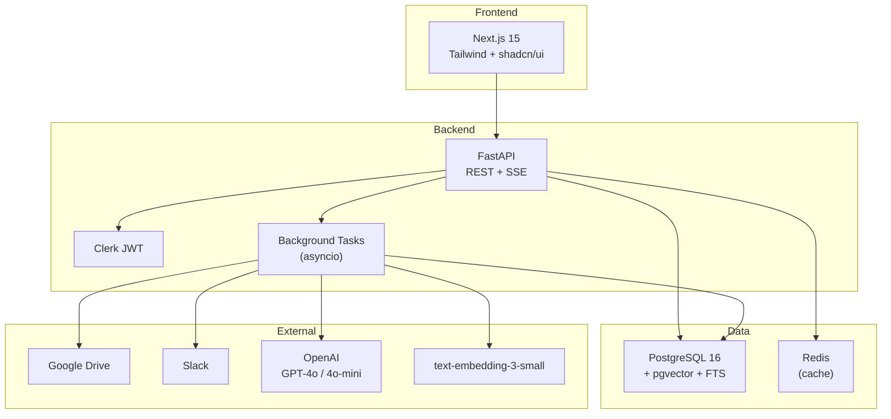

# ContextOS — 5-Day MVP Roadmap

> **Historical (October 2026).** This early plan is not used. It names Clerk, FastAPI and PostgreSQL; the
> app is built on Hono, SQLite and our own sign-in (Better Auth). See [decisions.md](decisions.md) and
> [api-reference.md](api-reference.md) for the current stack.

> **Goal:** A working demo that connects to real tools, reconstructs project context, renders a Knowledge Hub, answers questions with citations, and shows a basic learning path — in 5 days.

---

## Scope Decisions

### ❌ Explicitly Skipped (per your direction + time constraints)

| Feature Area                                                                         | PRD Reference          | Why Skipped                                 |
| ------------------------------------------------------------------------------------ | ---------------------- | ------------------------------------------- |
| **Employee Reward System**                                                           | §7.10, §7.12, §8.2–8.5 | Per your request                            |
| **Gamification** (points, badges, tiers, leaderboards, kudos, bounties, anti-gaming) | §7.10, §8.2–8.5, §8.3  | Part of reward system                       |
| **EPM / Performance Management**                                                     | §7.13 (Phase 2)        | Already Phase 2 in PRD                      |
| **Knowledge Maintenance** (flags, corrections, verification, domain owners)          | §7.9                   | Post-MVP refinement                         |
| **Conflict Detection & Resolution**                                                  | §8.6, §8.1.4           | Complex — needs stable context engine first |
| **Temporal Reconciliation** (supersession, valid_from/valid_to)                      | §8.1.1, FR-CTX-007/008 | Simplify to "latest wins" for MVP           |
| **Full Permission Parity** (ACL fingerprints, per-source access mirroring)           | §8.7, §19              | Workspace-level access only for MVP         |
| **Probation Dashboard & Health**                                                     | §7.8 (FR-PRB-004–010)  | Post-MVP                                    |
| **Mentorship Module**                                                                | §7.11                  | Post-MVP                                    |
| **Notification & Nudge Engine**                                                      | §7.14, §13             | Post-MVP                                    |
| **Slack App**                                                                        | §10.43 (Phase 1.5)     | Post-MVP                                    |
| **Billing & Payments**                                                               | §7.19                  | Post-MVP                                    |
| **Admin Console** (most panels)                                                      | §7.17                  | Minimal admin only                          |
| **Webhook Incremental Sync**                                                         | FR-INT-007             | Polling/manual re-sync only                 |
| **AI Agent API / MCP**                                                               | §7.18 (Phase 3)        | Phase 3                                     |

### ✅ MVP Scope (Minimal Feature Set)

| Feature                         | What We Build                                                                                                     | PRD Reference        |
| ------------------------------- | ----------------------------------------------------------------------------------------------------------------- | -------------------- |
| **Auth & Workspace**            | Clerk sign-in, create workspace, invite users (email)                                                             | FR-WS-001, FR-WS-003 |
| **Google Drive Connector**      | OAuth, select folders, one-shot backfill of Docs/PDF                                                              | FR-INT-001           |
| **Slack Connector**             | OAuth, select channels, one-shot backfill of messages/threads                                                     | FR-INT-002           |
| **Context Engine (Simplified)** | Normalize → chunk → embed → basic entity/claim extraction via LLM                                                 | FR-CTX-001–005       |
| **Project Knowledge Hub**       | Create project, auto-generate 4–5 sections (Overview, Decisions, People, Current State, Resources) with citations | FR-HUB-001–005       |
| **Ask ContextOS**               | RAG Q&A with streaming, inline citations, "insufficient evidence" handling                                        | FR-ASK-001–004, 006  |
| **Learning Path (Read-Only)**   | Auto-draft a path from hub content, checklist viewer, basic progress (manual check-off)                           | FR-LRN-001, 002, 009 |
| **Basic Onboarding Plan**       | Assign a path to a new hire with start date                                                                       | FR-PRB-001           |

---

## Tech Stack (as per PRD §15, simplified)

| Layer       | Tool                                                           |
| ----------- | -------------------------------------------------------------- |
| Frontend    | Next.js 15 + TypeScript + Tailwind + shadcn/ui                 |
| Backend     | Python 3.12 + FastAPI + Pydantic v2 + SQLAlchemy 2.0           |
| Database    | PostgreSQL 16 + pgvector                                       |
| Cache/Queue | Redis (cache only for MVP; skip Celery — use background tasks) |
| Auth        | Clerk                                                          |
| LLM         | OpenAI (GPT-4o for synthesis, GPT-4o-mini for extraction)      |
| Embeddings  | `text-embedding-3-small`                                       |
| Storage     | Local filesystem or S3 for raw docs                            |
| Deploy      | Docker Compose (local dev); Vercel + Railway/Render for demo   |

---

## Day-by-Day Plan

---

### 📅 Day 1 — Foundation, Auth & Connectors Setup

**Target:** Project scaffolded, auth working, OAuth flows for Google Drive & Slack functional, basic ingestion of raw data.

#### Morning (4h)

| Task                              | Details                                                                                                      | Est. |
| --------------------------------- | ------------------------------------------------------------------------------------------------------------ | ---- |
| **Scaffold monorepo**             | `/frontend` (Next.js 15 App Router) + `/backend` (FastAPI) + `docker-compose.yml` (Postgres+pgvector, Redis) | 1h   |
| **Database schema (core tables)** | `tenants`, `users`, `connectors`, `source_scopes`, `source_objects`, `chunks` — use Alembic migration        | 1.5h |
| **Clerk integration**             | Sign-in/sign-up page, JWT middleware on FastAPI, `users.me` endpoint                                         | 1.5h |

#### Afternoon (4h)

| Task                       | Details                                                                                                                                                            | Est. |
| -------------------------- | ------------------------------------------------------------------------------------------------------------------------------------------------------------------ | ---- |
| **Google Drive connector** | OAuth 2.0 flow → store token → list folders/shared drives → fetch Docs (export as text), PDFs (basic text extraction) → store as `source_objects`                  | 2h   |
| **Slack connector**        | OAuth v2 bot flow → store token → list public channels → fetch `conversations.history` + `conversations.replies` for selected channels → store as `source_objects` | 2h   |

#### Day 1 Exit Criteria

- [ ] Can sign in via Clerk and see a blank dashboard
- [ ] Can connect Google Drive and Slack via OAuth
- [ ] Can select channels/folders and trigger a backfill
- [ ] Raw text from Drive docs and Slack messages stored in `source_objects`

---

### 📅 Day 2 — Context Engine: Chunking, Embedding & Extraction

**Target:** Raw source objects processed into searchable chunks with embeddings, and basic entities/claims extracted.

#### Morning (4h)

| Task                       | Details                                                                                                                                       | Est. |
| -------------------------- | --------------------------------------------------------------------------------------------------------------------------------------------- | ---- |
| **Chunking pipeline**      | Structure-aware splitting: Docs by headings (300–800 tokens), Slack by thread, heading paths preserved. Store in `chunks` table               | 1.5h |
| **Embedding pipeline**     | Batch embed all chunks via `text-embedding-3-small`, store vectors in pgvector column                                                         | 1h   |
| **Full-text search setup** | `tsvector` column on chunks, GIN index — enables hybrid search                                                                                | 0.5h |
| **Backfill orchestration** | Background task (FastAPI `BackgroundTasks` or simple async): fetch → normalize → chunk → embed. Progress tracking via simple job status table | 1h   |

#### Afternoon (4h)

| Task                  | Details                                                                                                                                                                                      | Est. |
| --------------------- | -------------------------------------------------------------------------------------------------------------------------------------------------------------------------------------------- | ---- |
| **Entity extraction** | LLM prompt (GPT-4o-mini) on chunks → extract entities: Person, Project, Component, Decision, Term. Store in `entities` table. Use batch processing                                           | 2h   |
| **Claim extraction**  | LLM prompt on chunks → extract atomic claims with evidence spans (e.g., "Service A uses Kafka", "Decision: migrate to Stripe"). Store in `claims` table with `evidence` links back to chunks | 2h   |

> **Simplification:** Skip temporal reconciliation and conflict detection. All claims are status `inferred`. No `valid_from/valid_to` logic — just `source_time` and `ingested_at`.

#### Day 2 Exit Criteria

- [ ] All ingested source objects chunked and embedded in pgvector
- [ ] Full-text search index built
- [ ] Entities extracted and stored (People, Components, Decisions, Terms)
- [ ] Claims extracted with evidence spans linking back to source chunks
- [ ] Can run a simple SQL/vector query and get relevant chunks back

---

### 📅 Day 3 — Project Hub Generation & Hub UI

**Target:** Auto-generate a structured Knowledge Hub from extracted claims/entities and render it in the frontend.

#### Morning (4h)

| Task                      | Details                                                                                                                                                                                                                                                                                                                              | Est. |
| ------------------------- | ------------------------------------------------------------------------------------------------------------------------------------------------------------------------------------------------------------------------------------------------------------------------------------------------------------------------------------ | ---- |
| **Project creation API**  | `POST /projects` — name, description, select source scopes (channels + folders)                                                                                                                                                                                                                                                      | 0.5h |
| **Hub section synthesis** | LLM generates 5 sections from the project's claims & entities: **Overview** (what it is, problem, team), **How It Works** (architecture/process), **Decision Log** (extracted decisions as cards), **People & Ownership** (who works on what), **Key Resources** (canonical docs/links). Store as `hub_sections` + `section_renders` | 2.5h |
| **Citation linking**      | Each rendered paragraph links to claim_ids → evidence_ids → source chunks. Ensure every statement has ≥1 citation                                                                                                                                                                                                                    | 1h   |

#### Afternoon (4h)

| Task                           | Details                                                                                                                                                                                              | Est. |
| ------------------------------ | ---------------------------------------------------------------------------------------------------------------------------------------------------------------------------------------------------- | ---- |
| **Hub UI — Shell**             | Left nav with sections, project header (name, source count, last updated), section content area                                                                                                      | 1.5h |
| **Hub UI — Section rendering** | Render each section's content blocks. Each claim shows an `Inferred` chip. Clicking a citation opens a **Source Drawer** (side panel showing the original text span, source tool icon, author, date) | 2h   |
| **Projects list page**         | Simple card grid of all projects with name, description, section count                                                                                                                               | 0.5h |

#### Day 3 Exit Criteria

- [ ] Can create a project by selecting Slack channels + Drive folders
- [ ] Hub auto-generates 5 sections with cited content
- [ ] Hub renders in the browser with section navigation
- [ ] Clicking a citation opens the Source Drawer showing the original evidence
- [ ] Empty states show "Not enough evidence yet"

---

### 📅 Day 4 — Ask ContextOS (RAG Q&A)

**Target:** Working natural-language Q&A with streaming responses, inline citations, and honest "I don't know" answers.

#### Morning (4h)

| Task                       | Details                                                                                                                                                                                                       | Est. |
| -------------------------- | ------------------------------------------------------------------------------------------------------------------------------------------------------------------------------------------------------------- | ---- |
| **Retrieval pipeline**     | Hybrid search: BM25 (tsvector) top-30 + vector similarity top-30 → simple RRF merge → rerank top-10 by recency + relevance. Scope to project's source objects only                                            | 2h   |
| **Answer generation**      | Build prompt with retrieved evidence chunks (delimited as untrusted data). Generate structured answer: direct answer + rationale + citations + uncertainty. Use GPT-4o with Answer Contract (simplified JSON) | 1.5h |
| **Streaming SSE endpoint** | `POST /ask/threads/:id/messages` returns SSE stream. First token target < 3s                                                                                                                                  | 0.5h |

#### Afternoon (4h)

| Task                               | Details                                                                                                                                               | Est. |
| ---------------------------------- | ----------------------------------------------------------------------------------------------------------------------------------------------------- | ---- |
| **Ask UI — Chat interface**        | Left panel: thread list (private to user). Center: conversation with answer blocks (Answer, Context, Sources list). Scope selector (project dropdown) | 2h   |
| **Ask UI — Citation interactions** | Inline `[1]` markers that highlight on hover and open Source Drawer on click. Each answer shows source cards (tool icon, title, date)                 | 1h   |
| **Feedback & edge cases**          | 👍/👎 buttons on each answer. "Insufficient evidence" response when retrieval returns < 3 relevant chunks. Follow-up questions within a thread        | 1h   |

#### Day 4 Exit Criteria

- [ ] Can ask a question scoped to a project
- [ ] Get a streaming answer with inline citations `[1]`, `[2]`
- [ ] Clicking citation opens the exact source evidence
- [ ] System says "I don't have enough evidence" when appropriate
- [ ] Can have follow-up conversations in a thread
- [ ] 👍/👎 feedback captured

---

### 📅 Day 5 — Learning Paths (Minimal) + Polish + Deploy

**Target:** Auto-draft a simple learning path from hub content, basic path viewer, wire up onboarding plan, polish the whole app, deploy.

#### Morning (4h)

| Task                      | Details                                                                                                                                                                                                                                                                                           | Est. |
| ------------------------- | ------------------------------------------------------------------------------------------------------------------------------------------------------------------------------------------------------------------------------------------------------------------------------------------------- | ---- |
| **Path auto-draft API**   | `POST /learning/paths/generate` — inputs: project, role (optional). LLM generates an ordered list of 8–15 learning items from the hub sections (Read hub section, Explore decision, Review resource). Each item: title, objective ("why this matters"), estimated time, linked hub section/source | 1.5h |
| **Path viewer UI**        | Left: module outline (checklist with states). Center: item content (embedded hub section preview or source link). Items can be manually marked complete (checkbox — no automated verification in MVP)                                                                                             | 1.5h |
| **Basic onboarding plan** | `POST /probation/plans` — assign a path to a user with a start date. Home page shows "Your Learning Path" with progress % and next item                                                                                                                                                           | 1h   |

#### Afternoon (4h)

| Task                    | Details                                                                                                                                                     | Est. |
| ----------------------- | ----------------------------------------------------------------------------------------------------------------------------------------------------------- | ---- |
| **Home page**           | New hire variant: greeting, day counter, next 3 items, progress bar, link to hub, Ask bar. Simple variant for non-new-hire users: list of projects, Ask bar | 1h   |
| **Navigation & polish** | Left sidebar (Home, Projects, Ask, Learning), ⌘K search (simple: jump to project/section), responsive layout, loading states, error states                  | 1h   |
| **Deploy**              | Docker Compose for demo; or Vercel (frontend) + Railway (backend + Postgres + Redis). Environment variables, Clerk production keys, OpenAI key              | 1h   |
| **Smoke test & fixes**  | End-to-end walkthrough: sign up → connect tools → backfill → view hub → ask question → view path. Fix critical bugs                                         | 1h   |

#### Day 5 Exit Criteria

- [ ] Can auto-generate a learning path from a project hub
- [ ] Path viewer shows items as a checklist, items link to hub sections
- [ ] Can assign a path to a user and see it on their home page
- [ ] Home page shows personalized "Up Next" for assigned users
- [ ] App is deployed and accessible via URL
- [ ] Full walkthrough works end-to-end without crashes

---

## Architecture Overview (MVP Simplified)



---

## MVP Database Schema (Simplified)

Only the tables we actually build in 5 days:

```
tenants           (id, name, slug, settings)
users             (id, tenant_id, clerk_id, email, name, role, is_new_hire, start_date)
connectors        (id, tenant_id, provider, status, auth_token_ref)
source_scopes     (id, connector_id, scope_type, external_id, name)
source_objects    (id, tenant_id, scope_id, provider, object_type, external_id,
                   url, title, author, content_text, created_at_src, content_hash)
chunks            (id, source_object_id, tenant_id, ordinal, text, token_count,
                   heading_path, tsv, embedding vector(1536))
projects          (id, tenant_id, name, slug, description, status)
project_scopes    (project_id, source_scope_id)
entities          (id, tenant_id, project_id, type, canonical_name, aliases, attributes)
claims            (id, tenant_id, project_id, subject_entity_id, statement_text,
                   claim_type, status='inferred', source_time, ingested_at)
evidence          (id, claim_id, chunk_id, source_object_id, span_start, span_end)
hub_sections      (id, project_id, section_key, content_json, generated_at)
ask_threads       (id, tenant_id, user_id, project_id, title)
ask_messages      (id, thread_id, role, content, answer_json, feedback)
answer_citations  (id, message_id, claim_id, chunk_id, ordinal)
learning_paths    (id, tenant_id, project_id, title, status)
learning_items    (id, path_id, ordinal, type, title, objective, est_minutes,
                   target_section_key, target_source_id)
path_assignments  (id, path_id, user_id, start_date, status)
item_progress     (id, assignment_id, item_id, state, completed_at)
```

---

## Risk Mitigation for 5-Day Sprint

| Risk                                | Mitigation                                                                                    |
| ----------------------------------- | --------------------------------------------------------------------------------------------- |
| **OAuth setup takes too long**      | Pre-register Slack/Google apps on Day 0. Have test credentials ready                          |
| **LLM extraction quality is poor**  | Use few-shot prompts with examples; accept "good enough" extraction — quality can be iterated |
| **Backfill is slow for large data** | Limit MVP to small corpora (50 docs, 10 channels, 3 months). Add progress indicators          |
| **Hub generation is unreliable**    | Cache generated sections; regenerate on demand. Show "generating..." skeleton states          |
| **Time pressure**                   | Day 5 afternoon is buffer. If Day 4 runs late, simplify learning paths to a static list       |

---

## What Comes Next (Post-MVP, Week 2+)

Once the 5-day MVP is validated, the next priorities would be:

1. **Jira + GitHub connectors** (extend the same connector framework)
2. **Webhook-based incremental sync** (real-time updates)
3. **Knowledge maintenance** (flags, corrections, verification)
4. **Automated checkpoint verification** (engagement tracking, real-work events)
5. **Permission parity** (ACL-based content filtering)
6. **Gamification & rewards** (when ready to incentivize maintenance)
7. **Probation dashboard & health computation**
8. **Notification engine**

---

> [!IMPORTANT]
> **Day 0 Prep (Today):** Before Day 1 starts, complete these:
>
> - Register Google Cloud project + enable Drive API + create OAuth credentials
> - Create Slack app on api.slack.com with bot scopes (`channels:read`, `channels:history`, `users:read`)
> - Set up Clerk account and create application
> - Get OpenAI API key with GPT-4o and embedding access
> - Set up GitHub repo for the project
